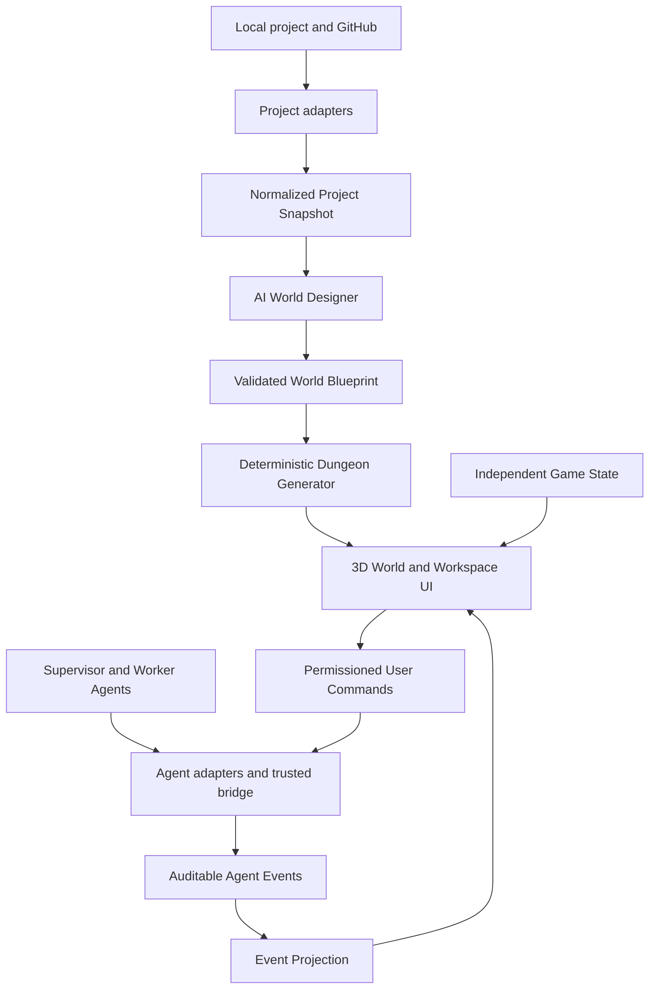

# Devungeon — proposed architecture

Status: design proposal, **not** implemented code. Refer to [PRD](PRD.md) for scope and UX.

## Four distinct domains

1. **Project truth domain** — inspect source data, normalize product capabilities / dependencies, represent unknown facts; verify acceptance with attributable evidence.
2. **Agent operations domain** — observe live Agent activity, grant explicit capabilities to send commands, record approvals, results and failures.
3. **World domain** — transform project graph into a persistent WorldBlueprint, perform procedural layout, incremental changes, navigation and room locks.
4. **Gameplay domain** — player movement, combat, loot, local progression and game replay, never used as evidence that a software task was delivered.

## Rules of ownership

- A `ProjectSnapshot` is the source of normalized **project facts**; only trusted evidence/reconciliation can change accepted/blocked/review states.
- A `WorldBlueprint` is an **AI or human proposal**; no generated geometry is automatically evidence of working software.
- `AgentEvents` capture **observations** with provenance, including offline or demo labels. UI may animate them but never invent silent real actions.
- `GameState` is **pure entertainment** and cannot update source project facts or Agent capabilities.
- Commands are emitted by an explicit user interaction through the trusted bridge and action permissions, not by in-world collisions, loot or game combat.

## Suggested stack

- Client: React + TypeScript + Vite, Three.js / React Three Fiber, Drei, Rapier, Zustand. Favor the currently stable compatible package versions during implementation.
- Runtime: local Node.js bridge for project/Agent APIs and event streaming; SQLite/file event log initially, transport via SSE or WebSocket if needed.
- Validation: JSON Schema / Zod at trust boundaries. Layout: stable IDs + seeds, incremental spatial packing and graph connectivity checks.
- UI: 3D renderer plus semantic overlays for chat, inspection, permissions and accessibility; fallback textual project view.
- Optional AI: World Designer emits only structured output and **cannot edit accepted states directly**.

## Trust boundaries

- The browser does not get provider tokens, GitHub tokens, cookies or decrypted secrets.
- Each Agent adapter advertises read-only or command capabilities, per-project scopes and its own status mapping.
- Destructive, paid, external publication and production actions require explicit user approval; game interaction is never equivalent to approval.
- Event log must support time, source, idempotency, explicit simulation status, and provenance links.
- No user private repo data should be included in the public repo, screenshots, examples or default telemetry.

## World generation algorithm (conceptual)

1. Import source, validate snapshot and freeze `revision`.
2. Build a stable semantic dependency graph (`project → zones → rooms → tasks`).
3. AI proposes names, themes, motifs and special room types. Disallow invented product facts.
4. Run deterministic layout using `seed + revision`, preserving pinned room coordinates from previous versions.
5. Place rooms/corridors/doors/prefabs, verify no intersections and check walkable paths.
6. Apply visual status projection, preserve history and animate only supported events.
7. If generation fails, show an intelligible fallback graph and diagnostics, rather than a broken fake 3D world.

## Required tests

- The two included synthetic projects validate against the canonical JSON schema.
- Re-importing the same project revision is deterministic.
- New feature does not arbitrarily move unchanged rooms.
- Locked room does not become player-accessible via clipping or teleport.
- A game Boss kill never sets `accepted` on a real work item.
- Real Agent actions require capability and approval, denied operations do not execute.
- Disconnected and simulated events are clearly visible, and replay cannot be mistaken for live mode.

## Approved original pixel-art presentation (2026-11-13)

The **world is spatially 3D**, the signature game's **presentation is pixel-art 2.5D**. Do not interpret React Three Fiber as an instruction to make smooth 3D cartoon assets. Use actual sprite sheets / tile textures (16×16 base grid recommended), nearest texture filtering, camera-aware sprite orientations, reduced pixel-scale resolution, simple tiled geometry and honest 3D collision. The first camera implementation should support discrete quarter-turn rotations and locked-room preview; unrestricted rotation is contingent on readability tests.

The semantic graph and Agent event projections must remain renderer-neutral and separate from the entertainment game state. Asset art is chosen by original license and ledger in docs/ASSET_PROVENANCE.md. Candidate packages and tradeoffs: docs/TOOLS_AND_SKILLS.md.
