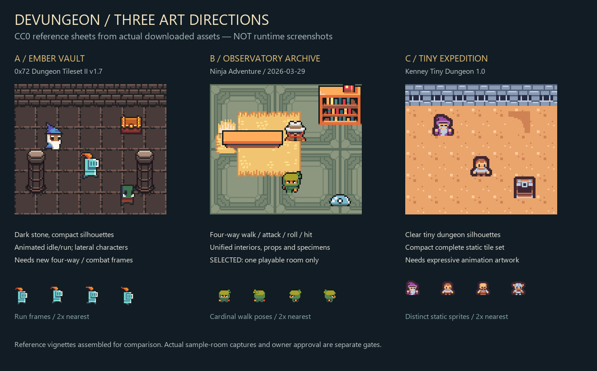

# First Play: the Observatory archive

Decision date: 2026-11-14. Scope: **one sample room** in the first pixel dungeon pack. This decision does not reskin every generated world. Product-owner visual approval is still required before a wider replacement.

## Directions considered

| Direction | Source and permission checked | Strength for this task | Cost / limitation | Decision |
| --- | --- | --- | --- | --- |
| Ember vault | [0x72 Dungeon Tileset II v1.7](https://0x72.itch.io/dungeontileset-ii), Robert / 0x72, CC0 assets | Strong dark-stone dungeon palette, animated creatures, readable treasure and weapon silhouettes; 16-pixel tile grid | Character animation is primarily lateral; no native attack/death sequence. Adding four-direction movement and richer work behavior would require substantial new artwork. | Keep as a coherent alternative, do not mix into the sample. |
| Observatory archive | [Ninja Adventure](https://pixel-boy.itch.io/ninja-adventure-asset-pack), Pixel-Boy and AAA, CC0 assets, archive dated 2026-03-29 | Actual directional characters, coordinated indoor surfaces/props and effects; a legible place to collect, inspect and test source evidence | Most environmental material favors adventure interiors rather than a traditional crypt. Requires deliberate room composition and selected crops. | **Selected.** Prioritize mature character motion and a convincing working room. |
| Tiny expedition | [Kenney Tiny Dungeon 1.0](https://kenney.nl/assets/tiny-dungeon), Kenney, CC0, 16×16 | Compact, consistent and inexpensive to integrate; 130 tiles/items/characters | Static character set leaves most animation work to this project; less expressive at the sample's camera distance. | Suitable for a simpler whole-world prototype, insufficient alone for this animation-focused sample. |

All three allow reuse and modification of the **art**, separately from editor or code licenses. The selected room uses one pack; no Soul Knight sprites, UI, fonts, music or room layouts are included. No paid assets, editors, accounts or new runtime packages are required.

This is a labeled asset comparison, not a runtime capture. Its [provenance record](evidence/first-play/art-directions-provenance.json) identifies the exact source archives, authors, hashes and composition. The runtime uses only the selected Ninja Adventure pack.

## Art direction

An underground observatory stores public project evidence. Warm stone walls frame carved sage paving and a furnished archive: a woven reading rug, wood source table, books and testing apparatus. A contrasting dark-stone practice zone stays open for combat. Small amber lamps and restrained task colors guide attention to stations, while silhouettes identify player, guide and monsters before labels are needed.

The source desk means “read the public project”; the evidence cabinet means “inspect the original records”; the test bench demonstrates a separately labeled scripted test. Their spatial meaning does not grant acceptance or permissions. A guide is explicitly DEMO; actual public reading belongs to the desk's program activity rather than a fictitious model worker.

## Production contract

- Use the pack's native 16-pixel grid with nearest filtering, no mipmaps or smooth resampling. Transparent sprite margins are cropped consistently so the texture bottom meets the collision feet.
- Keep one authored room layout. Interactive station footprints live in `SceneDefinition.props`, shared with collision; decorative clusters stay at the perimeter and out of door clearances.
- Environment art, game state and semantic evidence stay separate. A theme supplies textures and an environment node; it cannot change project acceptance or Agent permissions.
- Use actual frame sequences for movement and bounded work activities. Camera motion and hit feedback must remain comfortable; reduced-motion settings suppress optional moving decoration.
- Preserve the source archive hash, selected-file hashes, upstream path and modification recipe in the sample asset manifest and provenance ledger.

## Quality gate and rollout

The room must be inspected in a real browser at all four camera headings, while moving, turning, attacking and dodging. Inspect foot contact, wall clearance, station overlap, pixel sharpness, hit readability and FPS. Screenshot and video evidence belong with the integration report; code checks alone do not certify this direction.

After the product owner approves this one room, apply the same authored floor/wall rules, prop footprints and sprite pivots to another generated room, then retest seams and locked-area previews. Do not replace the full map before that approval. The legacy renderer remains the immediate rollback route for non-sample worlds.

Workflow references: [Three.js texture filtering](https://threejs.org/manual/en/textures.html), [Pixelorama source/editor license](https://github.com/Orama-Interactive/Pixelorama), [LDtk documentation](https://ldtk.io/docs/). No new editor or executable was installed for this sample.
