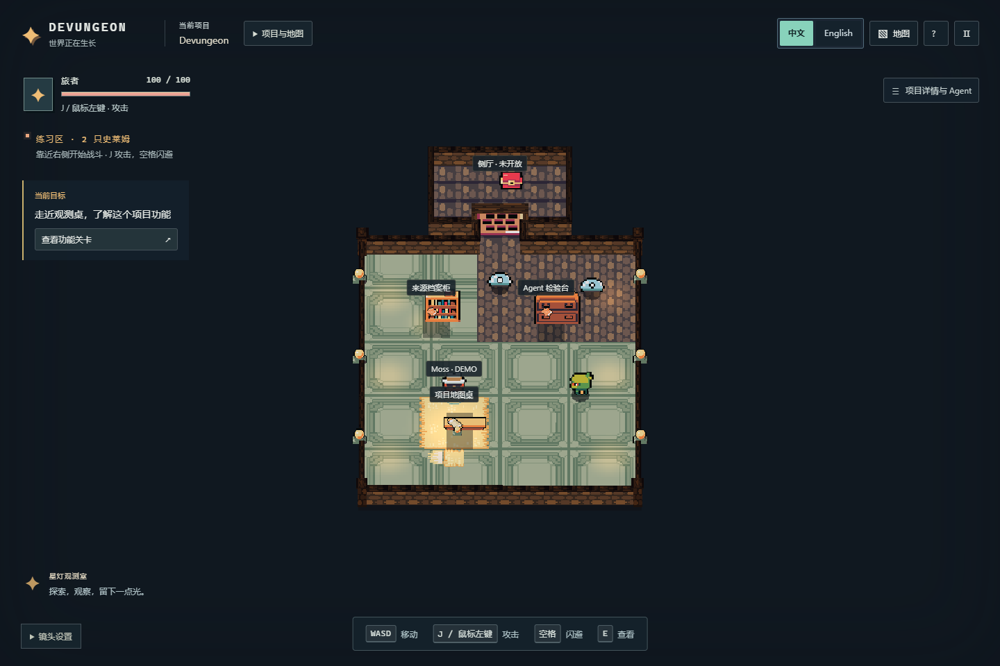
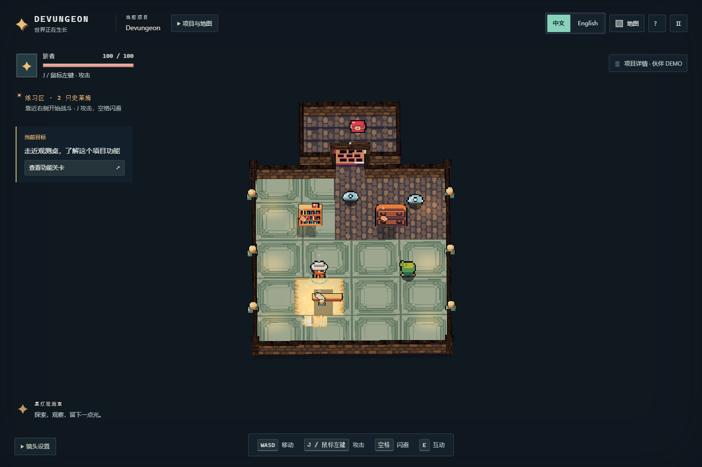
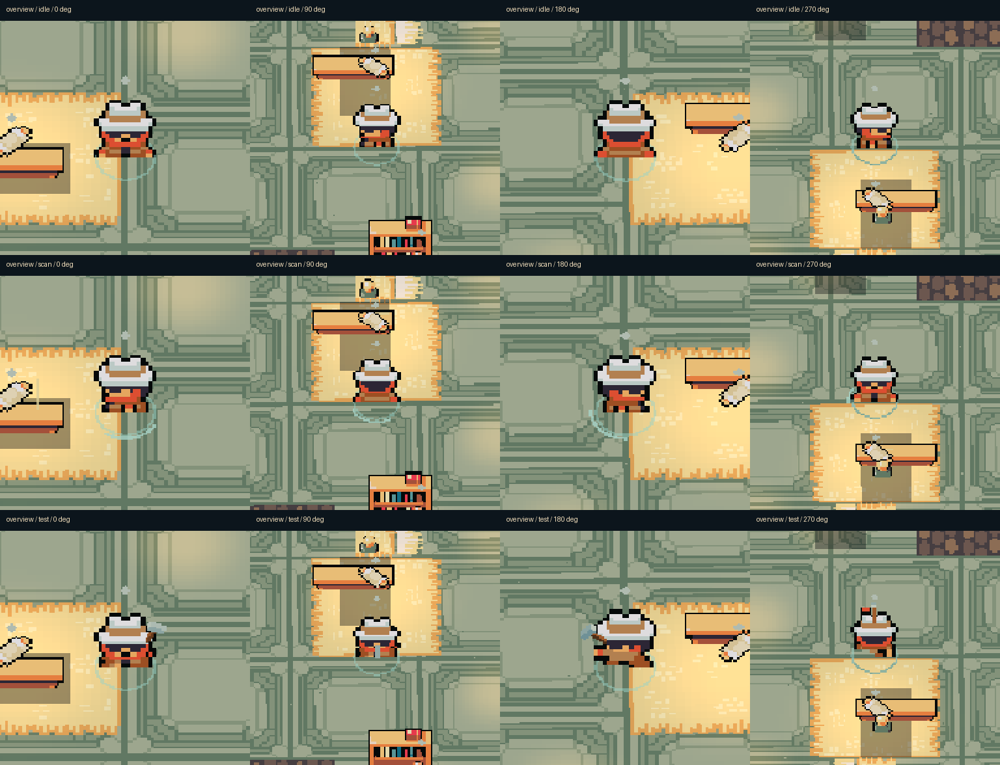
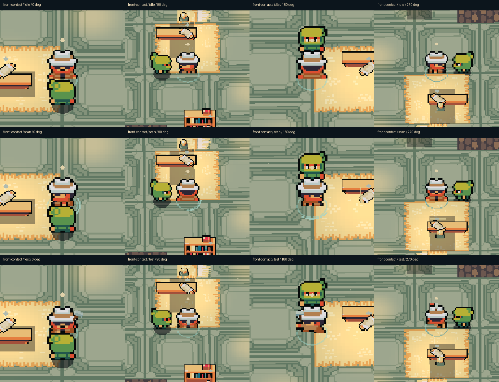
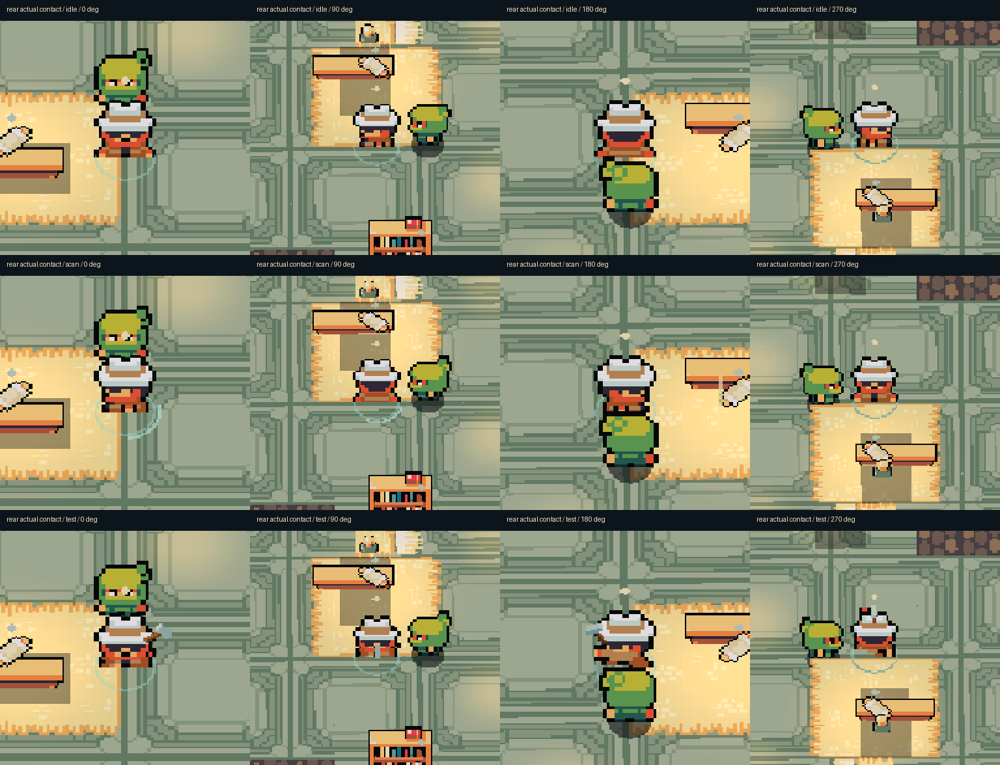

# PR #18 第二次试玩：三项修复

回应 [Issue #16 最新主管评论](https://github.com/orionaster/devungeon/issues/16#issuecomment-6875966184) 和 [PR #18 第二次试玩](https://github.com/orionaster/devungeon/pull/18#issuecomment-6875969562)。基线 `6dc35796c7d393bb6e3cdd332afc4e278401abb9`，继续使用独立工作区 `first-play` 和 `feat/first-play-upgrade`，目标仍为 `integration/wave2`。

**工程修复已实现并实际运行；动作舒适度、交互直观性和视觉验收仍待主管与产品负责人复验。** 没有合并、部署或改动其他 Agent 工作区。

## 修复内容与真实原因

| 问题 | 原因与修复 |
| --- | --- |
| 物品文字随玩家晃动 | 删除逐帧投影且避让玩家的 `.world-labels`。场景改为静止小菱形，附近出现屏幕固定的 `E 互动`；名称、任务与证据留在原有固定面板。五个目标保留实际点击、附近 E、中英地图 Tab/Enter 和包含目标名的无障碍名称。近邻选择使用距离滞回，避免两物边界反复切换。 |
| 移动与动作生硬 | 原生方向列 down/up/left/right 曾把 up/left 用反；走路/待机共用全局时钟，自动瞄准影响走路朝向。现在按实际位移推进步相，短停/转向保留步相，堵住时待机；移动跟随实际方向，攻击使用攻击方向，闪避锁定起始方向。动作使用独立计时并跟随真实平滑镜头选方向列。预加载图片的首用裁片同步填充，消除异步空白帧风险。 |
| Moss 只有半身 | 原生 Inspector 16×16 裁片完整；270° 投影文字覆盖身体。去掉文字后帽子、躯干和脚底完整可辨。保持原图、16×16 裁片、1.1 尺寸、脚底锚点、位置、深度和房间布局，未强制画在前景。 |

另查到英雄旧 32×24 裁片遗漏攻击 68 个、死亡 41 个不透明像素。改为完整 32×32，以原生第 24 行作脚底锚点，保持原像素尺度与落脚位置。翻滚正确播放三帧，去掉额外整体抬升。[原图 SHA256、每帧 alpha 范围](evidence/first-play-round2/atlas-coverage.json)、[精确诊断](evidence/first-play-round2/motion-sprite-diagnosis.md)。

原有 UI、美术包、镜头、关卡、移动速度、碰撞、数据与权限规则保持原设计。固定「项目详情 · 伙伴 DEMO」及 Moss 面板继续明确标注 DEMO。没有新增依赖、许可证或原图变化；[素材记录](ASSET_PROVENANCE.md) 已同步。

## 实际修复前后录像

同一机器、同一路线、同一生产入口，使用真实键鼠输入；没有游戏状态设置、传送、改血量或伪造事件。

- [修复前连续操作：122.81 秒](evidence/first-play-round2/before-motion.webm) / [读数](evidence/first-play-round2/before-motion.json)
- [修复后连续操作：122.16 秒](evidence/first-play-round2/after-motion.webm) / [读数](evidence/first-play-round2/after-motion.json)
- [CPU 六倍限速：62.68 秒](evidence/first-play-round2/low-budget-motion.webm) / [读数](evidence/first-play-round2/low-budget-motion.json)
- [Moss 修复前四镜头与动作](evidence/first-play-round2/moss-before.webm) / [修复后四镜头、三状态、背面接触](evidence/first-play-round2/moss-after-rear.webm)

连续录像覆盖斜向走、急停、反向、短按起步、攻击、闪避和四向转镜头。正常前后各 22 次攻击/闪避，限速段各 9 次；实际执行耗时自然不同。原生录像为 25 FPS，不能证明高刷新率主观观感。普通前后录像只做全长 VP9 CRF40 压缩，分辨率/时间保持，未剪辑、补帧、改速；其他三段为未修改的原生录像。[原始与提交文件 SHA256、大小、处理说明](evidence/first-play-round2/video-provenance.json)。原始录像和 trace 保留于本工作区 `output/playwright/firstplay-round2/`。




[仅隐藏标签的诊断图](evidence/first-play-round2/diagnosis-only-labels-hidden.png) 是基线上的临时诊断，不能当最终修复。最终影片和截图运行真实生产应用，没有注入隐藏样式。

## 本轮验证

2026-11-14，Windows 11 26200、Core Ultra 7 255H、Intel Arc 140T（ANGLE/D3D11）、Chrome 157.0.8103.78、Node 24.13.1 / npm 11.8.0、1440×960、DPR 1。生产服务 5194，独立公开数据桥 4334。真实自动浏览器输入和 Agent 逐图检查不等于产品负责人批准。

| 检查 | 实际结果 |
| --- | --- |
| TypeScript / 生产构建 | 通过：[check](evidence/first-play-round2/check.txt)、[build](evidence/first-play-round2/build.txt) |
| 自动化回归 | 187 通过：引擎14、集成27、世界55、工作台77、桥接14，含新增7项动画与2项近邻测试。[日志](evidence/first-play-round2/tests.txt) |
| 实际进程生命周期 | 1通过。[日志](evidence/first-play-round2/host.txt) |
| 样板产品 | 22通过：真实公开桥接 LIVE / 18条、不同 DEMO 任务与 REPLAY、工作/暂停隔离、战斗/重开不改事实、语言状态不变、外部写入405。[报告](evidence/first-play-round2/product.json) |
| 渲染/物理 | 15通过：移动/攻击/闪避镜头不倾斜，四方向墙、家具、伙伴及封闭门碰撞继续有效。[报告](evidence/first-play-round2/render.json) |
| 新交互 | 28通过：五目标实际点击、附近E、中英地图Tab/Enter、固定提示位置差小于0.1px、一次Esc恢复、语言不改事实/游戏，独立工作计时继续。[报告](evidence/first-play-round2/interactions.json) |
| 两个旧项目与工作台 | 61通过：两个不同世界、实际战斗胜负与重开、增量布局/切换、DEMO对话/任务、真实权限拒绝、工作/死亡隔离及中英状态不变。[报告](evidence/first-play-round2/legacy.json) |
| 提交录像播放 | Chrome实际解码全部5段1440×960影片，均无媒体错误。[播放记录](evidence/first-play-round2/media-playback.json) |
| Moss | 36张有效原始PNG：全景/正面接触/纠正后背面接触，各四镜头×待机/侦查/检验。逐图可辨完整帽子/身体/脚底。背面每图距离1.195101，闪避另测。[原图](evidence/first-play-round2/moss)、[全景/正面报告](evidence/first-play-round2/moss-overview-front.json)、[纠正背面报告](evidence/first-play-round2/moss-rear.json) |





贴近时后景玩家脚部有自然前后遮挡；没有使用前景覆盖绕过墙体/物件。两个旧项目的完整战斗、切换与增量地图、Agent工作台/拒绝权限回归单独执行；最终结果及媒体播放检查见 [汇总](evidence/first-play-round2/validation-summary.json)。

| 连续操作段 | 末尾滚动FPS | p95 | 全页最差帧 |
| --- | ---: | ---: | ---: |
| 修复前 | 142.42 | 9.6ms | 116.4ms |
| 修复后 | 142.42 | 9.0ms | 189.8ms |
| 修复后 CPU×6 | 35.18 | 56.8ms | 266.9ms |

FPS/p95 是最后900帧窗口；最差帧包括加载与截图。修复后最差帧更高，限速段有明显长帧，不能宣称性能全面提升或低端电脑完全流畅。动作验收依靠实际影片和试玩，不能用FPS或单元测试替代舒适度评判。物理低端设备、手机/Safari、新玩家与产品负责人试玩尚未执行。

## 失败和纠正

[失败记录](evidence/first-play-round2/failed-attempts.json) 不计入通过：

- 初次 Moss 后侧闪避后离开接触距离，原后侧12图无效。严格按每图距离重跑，闪避移到截图后测。初始报告标有 `verification_correction`，其113个原断言不能全计为有效接触验收。
- 初次语言断言错误包含独立工作计时 `now`。保留全量前后记录，继续比较全部事实/动作/回执/游戏，仅排除计时心跳，并额外等一次心跳确认事实不变。
- 两次E站位落在Moss/档案柜的滞回交界，正确选到Moss；测试改到档案柜明确邻域，保留标题断言。一次门前站位仍在2.25半径外，E未开面板，等待中被真实敌人击败；纠正站位后通过，未改交互半径、血量或敌人。
- 关闭面板的验证同时等待面板消失和焦点恢复，避免误读上一面板。没有删原有断言或降低业务检查。

## 复现与复验

```powershell
npm ci --ignore-scripts
npm run check
npm test
npm run build
npm run preview
# 使用实际输出端口；以下沿用本轮5194
$env:FIRST_PLAY_URL='http://127.0.0.1:5194'
node scripts/first-play-browser.mjs
node scripts/first-play-render.mjs
node scripts/first-play-interactions.mjs
node scripts/first-play-moss.mjs
$env:ROUND2_URL=$env:FIRST_PLAY_URL
$env:ROUND2_OUTPUT='output/playwright/firstplay-round2/reproduce-normal'
node scripts/first-play-motion.mjs
$env:ROUND2_CPU='6'
$env:ROUND2_DURATION='60000'
$env:ROUND2_OUTPUT='output/playwright/firstplay-round2/reproduce-low'
node scripts/first-play-motion.mjs
```

按顺序录制，避免前台浏览器争焦点。基线录像在修复前保存，复现脚本不会自动切回或覆盖分支。Moss支持 `FIRST_PLAY_MOSS_VANTAGE=behind-contact` 单独重跑背面。

既有大型 JS/WASM 构建提示保留。本轮没有调用真实模型、改权限操作、添加新世界或扩大美术替换范围。PR继续交主管与产品负责人复验，**不自行合并**。

## 远程 CI 导航纠正

产品修复与全部本机证据提交为 `da20e2b`。其远程 Windows 检查通过，工作台浏览器 17通过/2项既有opt-in跳过；Linux 的旧地图导航失败，尚未执行到样板渲染检查。[首次失败原日志](evidence/first-play-round2/linux-ci-navigation-failure.txt)。

失败发生在旧地图 `(0.623426, 0.371184)` 接近 `(0.5, 0.5)`，不是门锁或战斗断言。低帧率下，即使测试脚本只按4ms，一次渲染仍可能推进多个物理帧，单轴步长反复越过目标。仅继续缩短按键时长不能改变这个离散步长。

CI后续提交只改测试导航：在距路点0.5内、至少两次过冲且已降至低增益后，尝试一次真实双轴WASD，再读真实停止位置。归一化斜向步长能打破单轴震荡。全部按键在finally释放，严格0.16到达距离、存活/碰撞及业务断言均保留。没有改应用、游戏计时、速度、地图或摄像机；未重写已推送的产品提交。最终远程结果以原PR列出的当前检查为准。
