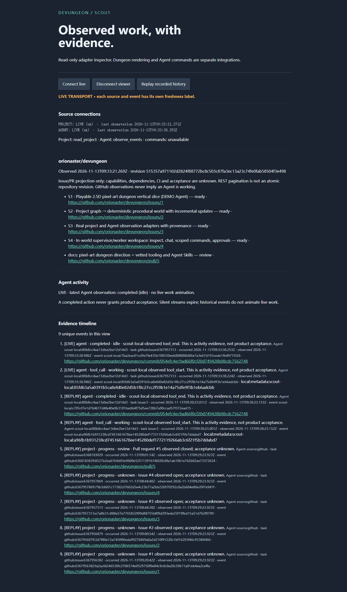
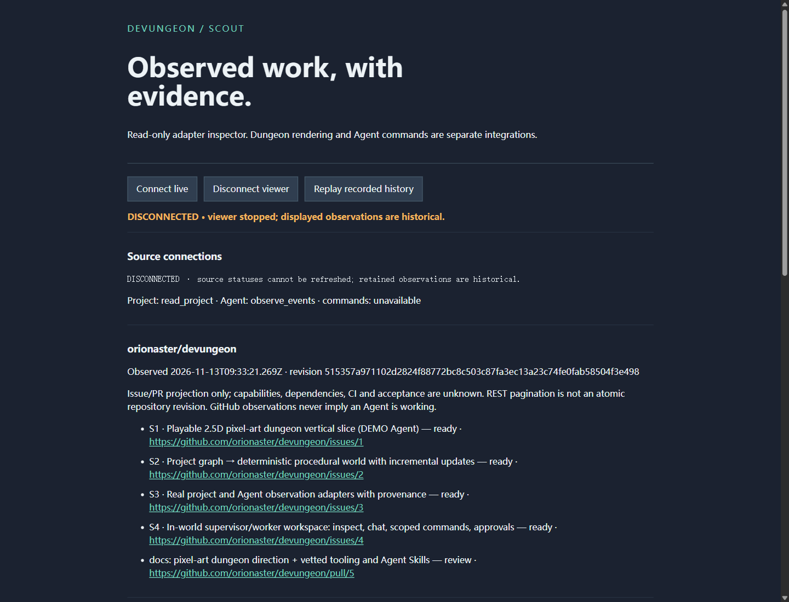
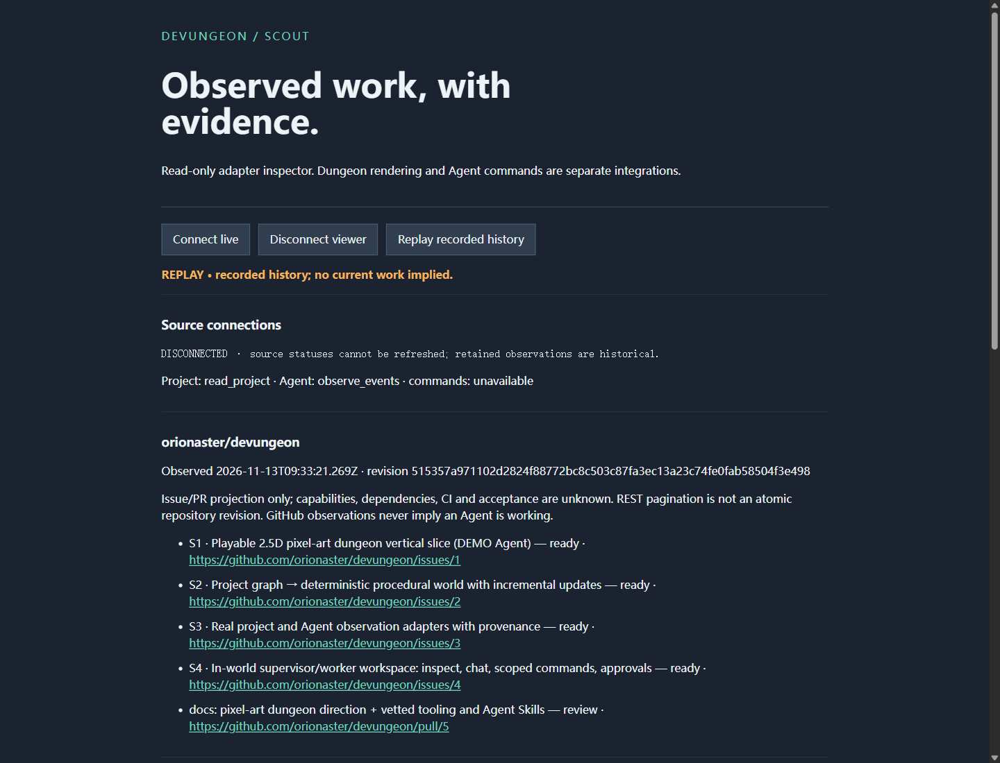

# SCOUT S3 verification — 2026-11-13

Scope: actual public project import and explicitly instrumented local SCOUT work
into a real browser **event inspector**, not a completed dungeon integration.
No private Agent logs/accounts, Crew content, keys, global hooks or paid services.

## Reproduce

Use a clean checkout of `feat/s3-scout-adapters`, Node >=24.13:

```powershell
cd apps/bridge
npm ci --ignore-scripts
npm run check
npm test
npm run verify:live
npm start -- --agent-file .devungeon-scout/scout-metadata.jsonl
```

Open <http://127.0.0.1:4313>. Source project becomes LIVE only after a successful
anonymous GET. Before a metadata file is present Agent is DISCONNECTED/unavailable.
Read `/v1/snapshot`, select the Issue #3 room ID; in a second terminal:

```powershell
node scripts/observe-git.ts C:\Devungeon\scout .devungeon-scout/scout-metadata.jsonl github:issue:6367957313
```

The exact checkout path may differ. The instrument only permits the public
Devungeon HTTPS remote. Expect two new Agent observations, tool_call and completed
(idle), with time, task ID, event ID and a public commit link. They do not change
any room to accepted. The action is fast: do not expect continuous work animation.
New event activity expires after 3 seconds; Agent source becomes STALE after
30 seconds without observations. GitHub is polled independently every 180 seconds.

Click Disconnect viewer: both transport and source-status display say
DISCONNECTED; no current animation. Click Replay recorded history: every returned
record is REPLAY. Click Connect live: backlog remains REPLAY; subsequent fresh
observations may be LIVE. Repeated polls never add the same IDs again.

Default state is local `.devungeon-scout/<selected-repository>/`; keep it ignored.
No automatic log rotation or deletion. Journal limit: 10,000 events / 20MB at
startup; metadata input limit: 2MB. Capacity/corruption fails closed. Preserve and
archive the directory and intentionally start a new selected directory/cursor
when needed. No multi-writer access: an exclusive writer.lock is required.
After a hard-killed process, verify its process is gone before manually removing
**only that journal's writer.lock**; preserve the events and snapshot. A partial
journal line requires deliberate repair; startup never silently truncates it.

## Actual results

- Windows, Node 24.13.1, npm 11.8.0. Type check passed. 11 offline tests passed:
  pagination/ETag/stable revision, honest closed/empty projects, permissions and
  rate limits, bounded selected input and sensitive-field rejection, provider
  filtering/lifecycle IDs, concurrent/restart dedup, corruption/multi-writer
  denial, real HTTP/SSE protocol and resume, Host/Origin/unsafe-command denial,
  malformed request target, mixed DEMO rejection, ordering and activity expiry.
- `npm run verify:live` passed at **2026-11-13 17:29:12 Asia/Shanghai**
  (`09:29:12Z`): public repository returned 5 work items and 5 source observations.
  Revision `515357a971102d2824f88772bc8c503c87fa3ec13a23c74fe0fab58504f3e498`.
  Source evidence includes [Issue #3](https://github.com/orionaster/devungeon/issues/3)
  (source update `08:44:38Z`, observed `09:29:12.158Z`). This revision is an import
  digest, not a source commit; future imports can differ.
- Real Chromium browser via official Playwright CLI 0.1.24, 1440×1100 viewport:
  public project facts appeared without credentials. Real SCOUT Git observations
  were received as LIVE at `09:33:38Z`, with task/room
  `github:issue:6367957313` and evidence commit
  [`054efc4`](https://github.com/orionaster/devungeon/commit/054efc4ec9ad66f0cf20d749428b08cdc7562748).
  This proves an actual locally instrumented read action, not a provider feed.
- Browser disconnect, replay and reconnect were operated. Replay returned 9 unique
  records; all 9 had REPLAY mode. Reconnect showed the same 9 IDs with no replay
  work animation. Four Agent records include two earlier instrument checks;
  the first check used an external `issue:3` label before task/room linking was
  corrected. The later check used the standard snapshot ID and persisted room_id.
- The browser showed DISCONNECTED for an initially missing metadata file and
  STALE after silence. HTTP permission/limit/network failures were injected in
  isolated offline tests, **not asserted as real GitHub account tests**. No private
  repository permission was requested. Initial favicon 404 was fixed with a 204
  route; intentional stopped-server attempts caused expected connection errors.
- The actual bridge was restarted preserving recorded events. Windows process
  termination left its lock file; after verifying no listener remained, only its
  scoped lock was removed. Journal corruption and stale-lock behavior are explicit
  limits, not automatic crash recovery.
- Existing Python synthetic schema/cross-reference validator and local Skill
  validator passed. npm audit reported zero known advisories in installed packages.
  CI is configured for Windows/Linux; do not equate configuration with a passed run.

Screenshots contain only public project information and scoped metadata:





## Not yet verified / integration boundaries

- HERO's actual 2.5D scene / WIZARD workspace has not been integrated or tested in
  this checkout. Shared contracts and same-origin proxy requirements are in
  [SCOUT-INTEGRATION](SCOUT-INTEGRATION.md). No game acceptance is claimed.
- Claude/Codex mappers have synthetic payload tests only. No Claude hook was
  installed, no App Server/account session was opened, no Crew data was accessed.
  Actual provider use needs separately scoped owner authorization and validation.
- Commands, approvals, chat, source writes, deployments and acceptance decisions
  are unsupported. All HTTP mutations are denied; credentials are never read.
- Import is an Issue/PR projection, not full product understanding: no CI,
  dependency inference, acceptance reconciliation or semantic room generation.
- This is a single-machine bounded journal foundation; no multi-process log,
  automatic rotation, durable power-loss guarantee, or production service claim.
