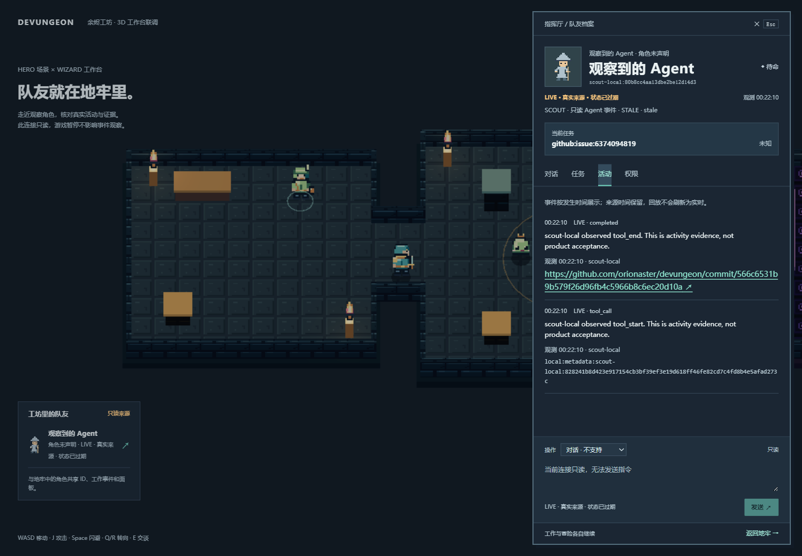
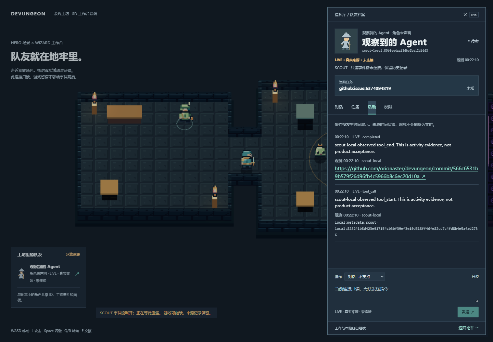

# SCOUT · integration wave 2 / Issue #12

Date: **2026-11-14 Asia/Shanghai**. Scope: the existing SCOUT worktree/branch and
PR #6. No force push, self-merge, provider account, real model call or private
Crew connection. Current main's PRD v1.3, I18N and ADR-0002 were incorporated by
merge commit `566c653`; README and schema README conflicts preserve both sides.
No new repository/worktree/feature branch or second world mode was created.

## Reviewable implementation

- `apps/bridge/src/same-origin.ts`: explicit loopback host middleware for
  snapshot/status/history/SSE. Fixed upstream and GET allowlist; exact Host/Origin;
  no Cookie/Authorization/Origin forwarding; validated queries and resume cursors;
  disconnected upstream is a bounded 502, not a successful live connection.
- `BridgeStatus`, `SnapshotEnvelope`, `EventEnvelope`: shared TypeScript delivery
  contracts. ProjectSnapshot and source event fields are unchanged. No locale,
  genre, geometry, gameplay, command or acceptance authority enters source facts.
- Fresh source status precedes the first live Agent record, so renderers no
  longer discard that action while still seeing DISCONNECTED. Future events
  remain REPLAY; both LIVE and DEMO connections expire to STALE after silence.
- No runtime dependency or lockfile was added/changed. Middleware uses Node HTTP,
  so root host consumes it without another React/Vite copy. The isolated host
  `npm ls` confirmed React/React DOM 19.3.1 deduped across R3F/workspace.

## Reproduce the SCOUT service and tests

```powershell
cd C:\Devungeon\scout\apps\bridge
npm ci --ignore-scripts
npm run check
npm test
npm run verify:live
# Use a new deliberately selected journal directory. Metadata may initially be missing.
npm start -- --data .devungeon-scout/wave2-proof --agent-file .devungeon-scout/wave2-metadata.jsonl --port 4318
```

The ordinary `npm start` default remains 4313. Hard-kill recovery is explicit:
first verify no bridge process/listener remains, then remove only the selected
journal's orphan writer.lock. Preserve event/snapshot files. The service never
silently resets or truncates logs. See the original validation record for limits.

## Isolated existing HERO/WIZARD scene proof

We did **not** merge another Agent's feature branch into SCOUT or change its
active workspace/node_modules. An ignored tracked-source export of published
WIZARD revision `fb953cacc55e8d12d5750c959bb20452c0954cd6` contains the existing
HERO scene and workspace. The only replacement is development configuration
mounting the new SCOUT middleware; game/workspace source is unchanged. The
Codex server development plugin is omitted entirely.

```powershell
cd C:\Devungeon\scout
powershell -NoProfile -File apps/bridge/scripts/prepare-host-smoke.ps1
cd .devungeon-scout/host-smoke/fb953cacc55e8d12d5750c959bb20452c0954cd6
npm ci --ignore-scripts
npm run build
node node_modules/vite/bin/vite.js --config packages/workspace-ui/vite.scout-smoke.config.ts
```

The script refuses to overwrite a prior export. Preserve it or deliberately
select a new reviewed revision. It records source revisions/middleware hash in
the export's scout-smoke-source.json. It never creates a git worktree/repository.

Open `http://127.0.0.1:4178/?source=hero&connection=scout`. After selecting Issue
#12's standard room ID from `/scout-read/v1/snapshot`, produce actual scoped work:

```powershell
cd C:\Devungeon\scout\apps\bridge
node scripts/observe-git.ts C:\Devungeon\scout .devungeon-scout/wave2-metadata.jsonl github:issue:6374094819
npm run verify:host -- http://127.0.0.1:4178 http://127.0.0.1:4318
```

Do not hand-create LIVE records. This instrument records its actual bounded Git
HEAD read and public commit reference. It is self-instrumented SCOUT work, **not**
a Claude/Codex provider subscription. No ongoing animation is inferred from it.

## Actual observations

- Windows / Node 24.13.1. Clean bridge install, type check and **14 offline tests
  passed**. New tests cover four-route host forwarding, path/credential/Host/
  Origin denial, bad query/cursor, unavailable upstream, source-before-record
  order, future timestamps and DEMO expiry. Existing examples/Skills validators
  pass including the two optional world-experience proposal fixtures.
- At **00:20:53 local** (`2026-11-13T16:20:53Z`), anonymous public GET imported 14
  source work items and 14 project observations. No room accepted. Digest
  `c8b96438774a1425fd92f6469cb0b41f7c717fbd83e9f30b1d33dbd5681635bd`.
- Through the actual Vite middleware, host/direct snapshots compared exactly,
  including English original Issue #12 title, IDs, evidence, observed_at and
  revision. Resume preserved the exact original event and cursor as REPLAY.
  [Machine-readable probe](evidence/scout/wave2-host.json) records these checks.
- Real Chromium, 1440×1000: before the instrument, gameplay was playing with
  **zero Agents**, despite 14 imported GitHub project events. The Git action at
  `16:22:10Z` then produced 2 observations / **one actual observed Agent**. Its
  source/task ID and commit evidence appeared in the existing 3D workspace;
  message/command controls were disabled. Silence displayed STALE.
- Actual D movement and Space dodge operated in that scene; dodge count became
  1. Opening the workspace paused combat while observation continued. Hard-stop
  of the selected bridge showed disconnected with 2 events retained; after the
  same journal restarted, the same 2 IDs returned as REPLAY, without duplicates.
  Player position `x=-3.8900000154972076,z=1`, HP 100 and dodge count 1 survived
  the transport reconnect unchanged. No project acceptance changed.
- Export's root build passed. Existing host warnings: large chunks, Radix
  `use client` bundling notice and THREE.Clock deprecation. Browser had no errors
  before intentional bridge shutdown; expected 502s occurred during disconnect.
  This is not a device-performance or full gameplay-acceptance claim.





## Supervisor review / remaining integration

The middleware and contracts are ready for HERO's primary app and WIZARD's common
locale integration; the example Vite seam is in SCOUT-INTEGRATION.md. This proof
uses their existing **3D integration scene**, not the final unified root product.
It does **not** complete Issue #12 by itself:

1. HERO/WIZARD still need to wire the selected public snapshot/project provenance
   UI and this middleware into the one primary host. The snapshot was verified
   via the same origin, but is not yet the generated playable map in this proof.
2. Full shared zh-CN/en-US switch and state-preservation remain with WIZARD/HERO.
   The checked scene has Chinese controls but no common language toggle. No
   duplicate locale state/catalogue was introduced by SCOUT. Original source
   strings remain intact; display enum/error labels use the host's catalogue.
3. Two BUILDER worlds, primary-host collision/combat acceptance, fresh combined
   checkout and user acceptance must be reviewed together by the integration
   owner. No second game mode or multi-world runtime is claimed.
4. Real provider command/control remains unconnected and requires separate
   authorization. SCOUT continues to advertise no commands/approvals.

Review PR #6's main reconciliation, fixed-route middleware, SSE ordering/freshness
and the evidence boundary above before integration. Do not self-merge. Remote CI
results must be checked at the final pushed commit; local results are not CI proof.
