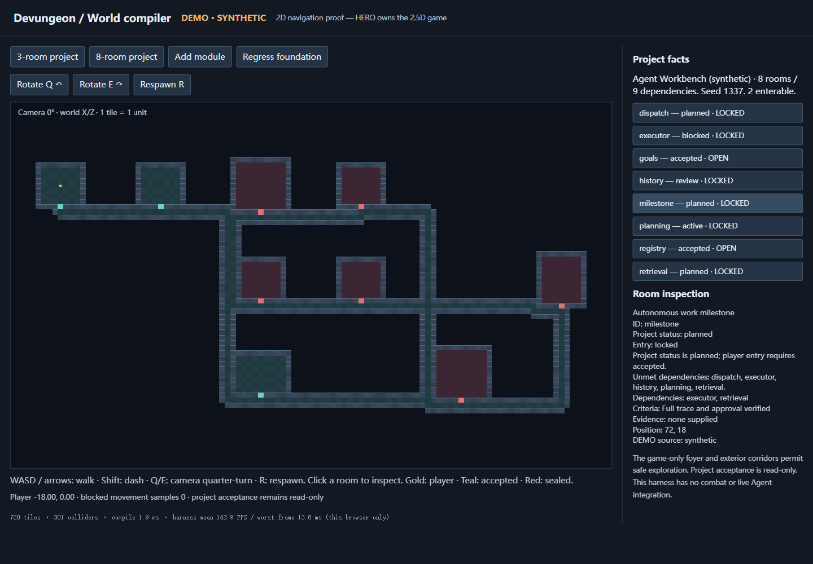

# @devungeon/world-generator

Runnable S2 project-to-world compiler. It turns the two bundled **synthetic**
projects into different navigable dungeons, with deterministic generation and
persistent incremental expansion. It does not connect to a live repository or
write project acceptance. HERO supplies the actual 2.5D renderer/combat engine.

From a checkout of this branch, on Node 24:

```powershell
cd C:\Devungeon\builder\packages\world-generator
npm ci --ignore-scripts
npm run build
npm test
npm run examples
npm run dev
```

Open [the local navigation harness](http://127.0.0.1:4274). WASD/arrows move, Shift
dashes, Q/E rotates by 90°, R respawns. Choose either fixture, inspect locked rooms,
add a module, or regress the foundation. The **2D diagnostic harness** is explicitly
DEMO; it is not the HERO 2.5D game or a live Agent integration.



Compile any canonical Snapshot v1 JSON with the CLI:

```powershell
New-Item -ItemType Directory -Force output | Out-Null
node dist/cli.js ../../examples/tiny-landing-page.json --seed 1337 --out output/site.world.json --save-layout output/site.layout.json
node dist/cli.js examples/tiny-landing-page-expanded.snapshot.json --seed 1337 --previous output/site.layout.json --out output/expanded.world.json
```

Create the destination directory first if using a new path. `--designer` takes a
proposal JSON, `--bounds` a bounds JSON. `--previous` takes the saved **layout**,
not a bare Blueprint. Exit 0 means valid world, 1 means diagnostic/fallback, 2 means
CLI/JSON/I/O error. Without `--out`, the world JSON goes to stdout. No partial world
is emitted on a generation failure.

```ts
import { compileWorld, createNavigator, toHeroScene } from '@devungeon/world-generator';

const result = compileWorld(snapshot, { seed: 1337, previous: savedLayout });
if (result.ok) {
  const { blueprint, scene, layout, graph } = result.world;
  // Persist layout and use it on every update. blueprint obeys root Schema v1.
  const nav = createNavigator(scene);
  player.position = nav.safeSpawn(player.position);
  player.position = nav.move(player.position, requestedPosition);
  // Optional S1 adapter: shifts to HERO's half-integer floor grid.
  const heroScene = toHeroScene(result.world, { includeEnemies: true });
} else {
  showDiagnostics(result.diagnostics, result.fallback_graph);
}
```

The output envelope contains:

| Field | Purpose |
| --- | --- |
| `graph` | Sorted semantic zones/features/dependencies/agents, original states/evidence/source, topological stages and explicit data gaps |
| `blueprint` | Unchanged canonical v1 room/zone/gate protocol, renderer-independent |
| `scene` | Seeded tile patterns, 3D collider boxes, door locks, exterior corridor paths, safe foyer, navigation, game-only encounter descriptors |
| `layout` | Versioned persistent reservations, original room geometry, all historical paths and removed-entity tombstones |
| `changes` | Added/retired/restored stable room IDs |
| `diagnostics` | Explicit warnings; failures return a valid graph fallback when one can be built |

Generation validates the actual root JSON schemas with Ajv2020, then checks IDs,
references, cycles and supplied acceptance evidence. A stable per-entity hash
chooses room size/prefab/variation; placement grows along the dependency graph and
keeps saved footprints/corridors reserved. rot.js A* routes four-neighbor exterior
paths. A flood fill independently verifies every open room and walkable tile is
reachable. Rooms are never transit corridors: each has one gated south doorway to
an exterior circulation network, so closed features cannot strand other open
components. Crossings are explicit exterior junctions, not extra project edges.

Entry is `own status === accepted` **and** all transitive prerequisites enterable.
Dependency regression can seal a factually accepted successor; the original
accepted status/evidence is retained. Locked interiors and doors have collision
boxes and are omitted from navigation. Swept movement blocks dash-through;
`safeSpawn` also rejects locked rooms/void after an update. Camera preview grants
no access. All encounters are game-only and expose no project-write capability.

All previous rooms, including non-accepted rooms, stay pinned. Adding a lower
sorting ID or a new zone does not move them. Rename/status/theme changes keep
geometry. Removed entities remain sealed tombstones; restoring their IDs reuses
their old locations. Retired paths remain visible historical passages, with no
power to unlock a feature. Reusing a layout with another seed/project/generator
version/bounds fails explicitly. Compaction/migrations are not implemented.

Optional AI design is constrained to this shape:

```json
{
  "schema_version": "1.0",
  "zones": [{ "zone_id": "experience", "theme": "observatory", "narrative": "A fictional star vault" }],
  "rooms": [{ "room_id": "hero", "title": "Star hall", "prefab": "archive" }]
}
```

Unknown keys/IDs, arbitrary geometry, status, evidence and dependencies are
rejected. Prefabs are `stone-chamber`, `workshop`, `archive`, `boss-arena`; saved
prefabs remain pinned. Titles/narrative are decorative text, not product facts.
The compiler has no model/network call and consumes no paid API budget.

See [the scene/adapter contract](docs/INTERFACE.md),
[actual validation and limitations](docs/VALIDATION.md),
[dependency decision](docs/DEPENDENCIES.md) and
[runtime license notices](THIRD_PARTY_NOTICES.md). Generated examples are under
`examples/`, including the additive analytics-module snapshot and its saved world.

Reproduce the keyboard browser proof after `npm run dev`:

```powershell
npx --yes --package @playwright/cli@0.1.24 playwright-cli --session builder open http://127.0.0.1:4274 --headed
npx --yes --package @playwright/cli@0.1.24 playwright-cli --session builder resize 1440 1000
npx --yes --package @playwright/cli@0.1.24 playwright-cli --session builder snapshot
npx --yes --package @playwright/cli@0.1.24 playwright-cli --session builder run-code --filename scripts/browser-proof.js
```

The optional HERO engine integration check needs a selected HERO checkout and its
installed dependencies. Build this package first, then from that checkout:

```powershell
cd C:\Devungeon\hero
node --import tsx C:/Devungeon/builder/packages/world-generator/scripts/verify-hero.mjs C:/Devungeon/hero
```

It reads but never edits the HERO checkout. Tests use actual HERO `Dungeon`,
`geometry`, `validateScene` and Rapier. Its output records hashes of the tested
engine files, since HERO is developing independently. This check is separate from
HERO browser rendering and cannot certify sprites/occlusion/manual play quality.
