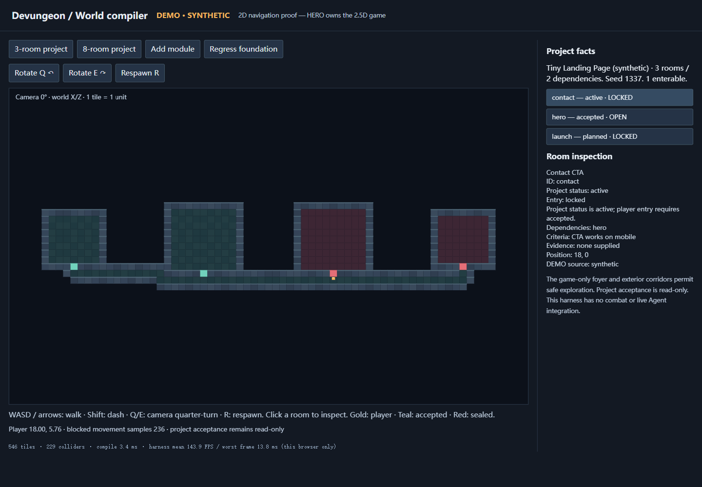
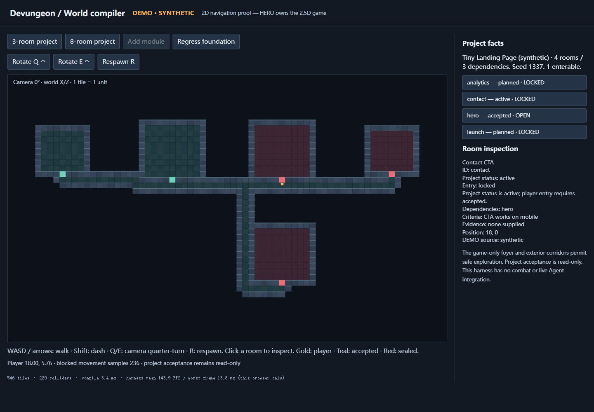
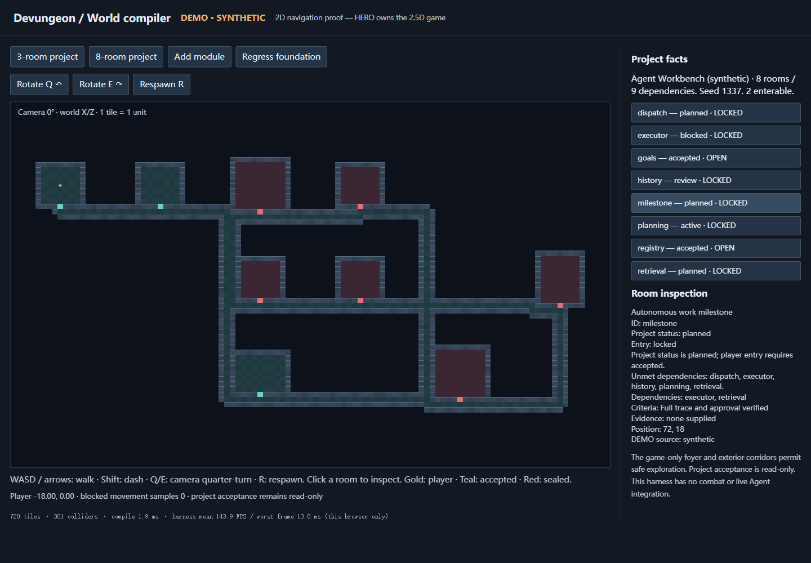
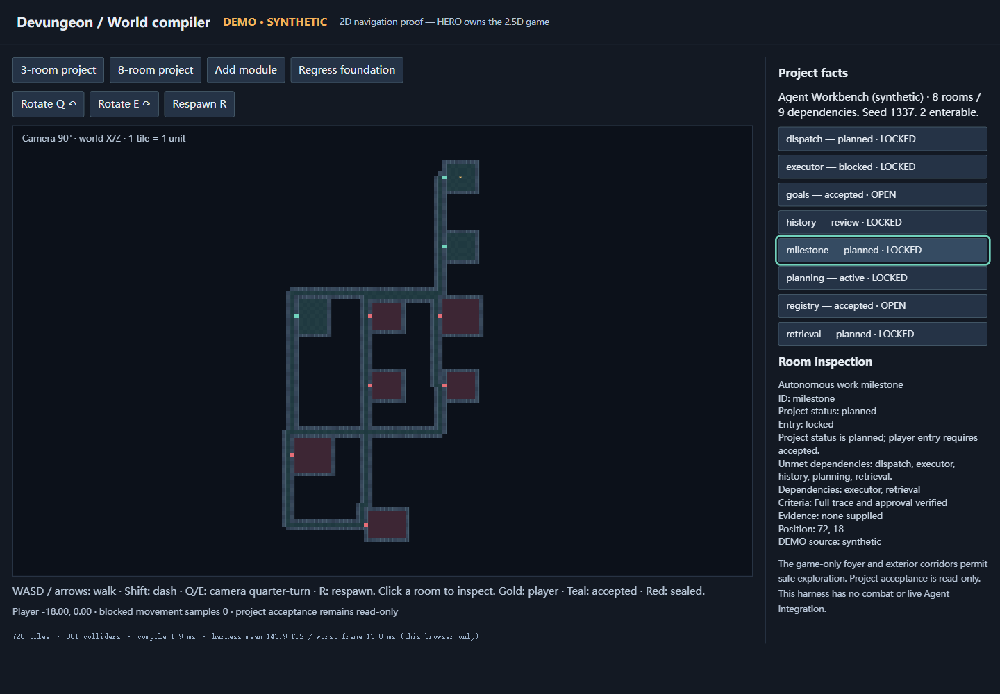

# S2 validation — 2026-11-13

Scope: the executable world compiler, its two synthetic project fixtures, local
navigation harness and actual HERO engine adapter. These checks do not establish
live project/Agent integration, human acceptance or a released game.

| Check | Actual result |
| --- | --- |
| Generator TypeScript build | PASS on Windows x64, Node 24.13.1 / TypeScript 7.0.2 |
| Vitest | **41 passed**, including 40 seeded generated-DAG cases and 30 incremental evolution cases; fast-check seeds 20261113 / 1337 |
| Canonical root examples/Skills | Both existing Python validators PASS; public schemas and original examples unchanged |
| Tiny project | 1 zone, 3 rooms, 2 dependency gates, 546 tiles; only `hero` enterable |
| Agent workbench project | 3 zones, 8 rooms, 9 dependency gates, 1565 tiles; `goals` and `registry` enterable |
| Determinism | Same source/seed/version byte-identical; source array reorder semantically identical; committed examples checked by tests |
| Incremental evolution | Lower-sorting feature/new zone added without changing old footprints, door locations or saved paths; rename/status/dependency updates, retire/restore tested |
| Trust/error cases | Schema errors, duplicate IDs, absent references, self/multi-node cycles, false demo flags, unverified real acceptance, hostile Designer keys/IDs and infeasible bounds produce explicit errors |
| Navigation | Independent truth oracle and flood/path checks: open rooms/all open tiles reachable; locked interiors absent from navigation; wall/door collision, dash, invalid position, void/teleport/respawn rejection tested |
| Persistence hardening | Extreme 1e100 room/foyer/path coordinates rejected before enumeration; bounds order is irrelevant and extra fields rejected; incompatible seed/project/version/bounds fail |
| HERO actual engine + Rapier | Both fixtures pass actual validateScene, exact floor raster and all adjacent-tile seam checks. 1011/6200 movement steps visit all accepted rooms. Dash attempts fail at all **8** locked doors. Two actual single-enemy encounters reach `won` without changing source Snapshot/graph/door locks. A 32-root long-corridor regression also passes. |
| Browser keyboard proof | PASS: walk from foyer into `hero`; reach `contact` porch; Shift-dash at its locked door at camera 0/90/180/270; inspect lock explanation; add module (all old room geometry unchanged); regress foundation (all gates lock); load 8-room fixture and rotate |
| Production build of harness | PASS, 184.15 kB JS / 55.15 kB gzip plus 3.17 kB HTML; local diagnostic, no public deployment |
| Dependency review | Exact installed Windows tree: 48 package licenses inspected; npm audit **0 vulnerabilities** at this check. Runtime BSD/MIT notices retained; MPL-2.0 build-only dependencies documented. No art/audio imported. |

Browser evidence used Playwright CLI 0.1.24 and Chrome 157 on Windows, viewport
1440×1000, DPR approximately 1. Hardware reported Intel Core Ultra 7 255H / Intel
Arc 140T. This is **not a low-end-device acceptance**. The observed harness sample
was ~144 FPS with a worst animation frame of ~13.8 ms over ~15.5 seconds; this is
the lightweight 2D harness, not a HERO gameplay performance claim. It used actual
keyboard events and read-only observations, not direct player-position injection.
Zero browser console errors/warnings remained in the inspected session.

The [browser report](evidence/report.json),
[actual engine report with source hashes](evidence/hero-integration.json) and
[benchmark measurements](evidence/benchmark.json) are committed. The complete
local Playwright trace is in ignored `.playwright-cli/traces/`; screenshots and
reports contain only the bundled synthetic project data. These are UI captures
of original diagnostic code, not imported game art.

Warm in-process compiler measurement (5 warmups, 25 measurements; module import,
schema compilation, I/O and rendering excluded): tiny median **2.30 ms**, p95
3.11 ms; complex median **5.94 ms**, p95 6.86 ms. These are one-machine observations,
not a large-project performance guarantee. Reproduce with `node scripts/benchmark.mjs`.

Independent Agent review reran the suite and found three issues: unbounded hostile
coordinate enumeration, bounds comparison/normalization, and a long-run HERO
rectangle seam. Each was fixed with a regression case; a final read-only recheck
reported no remaining blocking finding. That review does not substitute for a
human review or acceptance.

Limits and outstanding integration work:

- The browser harness is 2D. Generated layouts were exercised in the **actual
  headless HERO engine**, but their pixel sprites, 2.5D camera occlusion and full
  rendered combat loop still require HERO's browser integration. No manual human
  playtest, mobile/Safari check or public deployment is claimed.
- ProjectSnapshot v1 has zones/features/agents, not separate task entities,
  per-feature timestamps or granular unknowns. The compiler preserves these gaps
  and cannot verify whether supplied evidence actually proves acceptance.
- AI design is an optional validated proposal interface, not a connected model.
  Titles/themes are decorative; prefabs stay pinned once saved.
- Layouts have finite documented capacity. Tombstones and retired paths consume
  history budget; automatic compaction, seed/version migration and multiple floor
  heights are not implemented. Generation fails explicitly at impossible geometry
  or capacity rather than moving existing rooms silently.
- HERO S1 has narrower geometry/actor budgets than the canonical compiler. The
  adapter checks these and rejects unsupported scenes with `HERO_SCENE_LIMIT`.
- GitHub Actions adds Windows/Linux generator checks. Remote CI status belongs
  to the PR; local Windows results alone do not establish Linux success.

The PR is for supervisor review, not a merge or release authorization.
