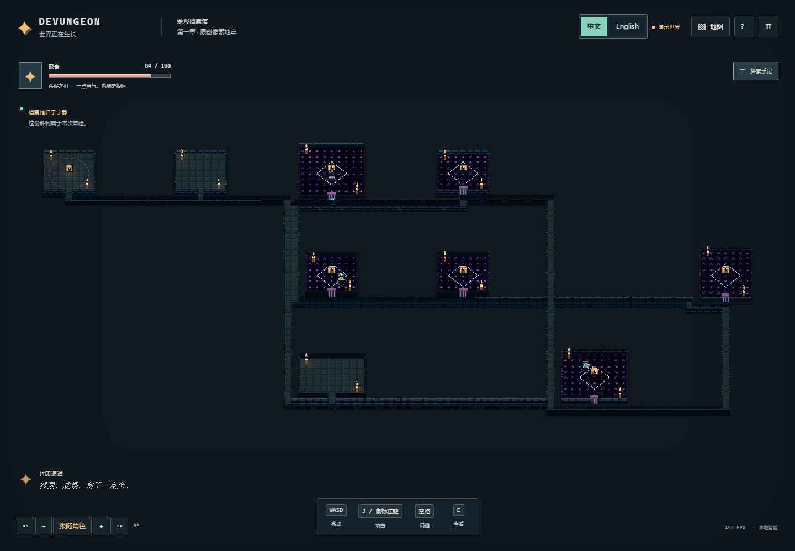
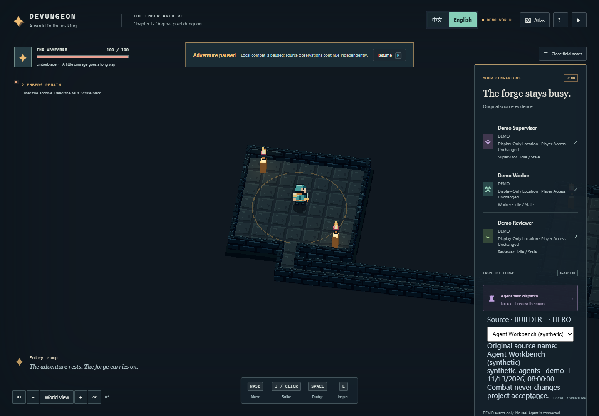
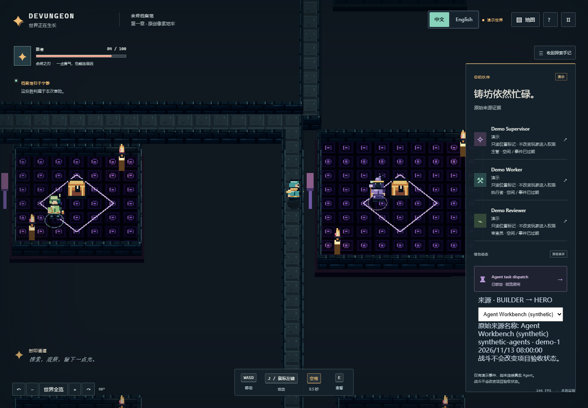
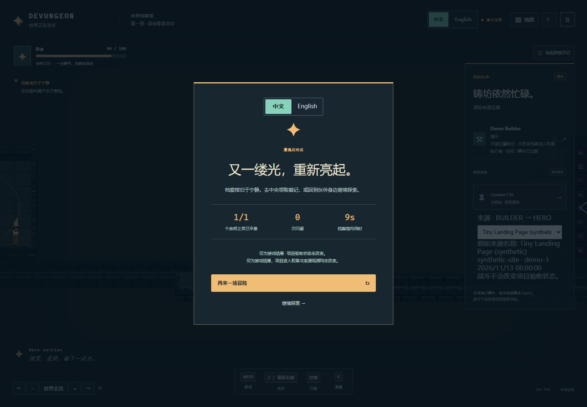
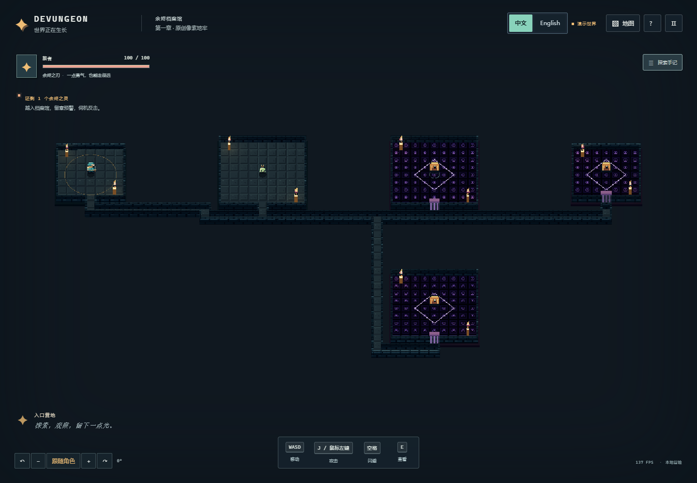

# BUILDER integration wave 2 — 2026-11-14

Refs #12 and #10. ADR-0002 / PRD v1.3 are retained from main. This is the
**first pixel-dungeon pack**, with a world-neutral validated facts port; no world
selector, city simulation or second game mode was implemented.

What is ready for review:

- `compileProjectGraph` exposes validated source facts without a seed/pack/locale.
- `toHeroScene` carries explicit doors, original project provenance and opt-in
  visual-only source Agent markers. Sealed rooms stay sealed. Source role/IDs/demo
  flags survive; unassigned Agents get no invented room assignment.
- A 34-key presentation sidecar uses WIZARD's shared translator/Provider. Original
  source and Designer prose are distinguished. Source evidence, timestamps and
  layout are not translated or rewritten.
- Two generated `.hero-scene.json` outputs and an actual-HERO consumer entry make
  both source projects reproducible through HERO's App / DungeonScene / Rapier.
  The entry adds only a fixture selector and display callbacks. It has no copied
  renderer, combat implementation, locale store, provider permission or backend.

| Executed check | Result |
| --- | --- |
| BUILDER build + automated suite | **55 passed**, including the original 70 seeded DAG/evolution property cases, explicit door/context/Agent-ID contract, source/design display separation and renderer budget boundaries |
| Existing root protocol/Skill validators | PASS with the updated main contracts, including the proposal-only experience examples |
| Original world outputs | Unchanged SHA-256: tiny `9d46817abfa058c65fa9b6d862c3013ae39f266288ffb0156fa08d7a62833bed`; complex `13a04edebcaf40aeea67a97f06bbc79d94b4408b5a39e77692ecb917f51d0fb1` |
| Actual HERO engine / Rapier | Both exact floor rasters, all open tile seams, explicit visible doors, locked-room visual markers and original IDs validated; 1011/6200 movement steps; all 8 fixture locks resist dash; combat wins leave facts/locks unchanged; 32-root long-run regression passes |
| Actual shared i18n | All 34 world keys present in both real catalogues; parity and nested interpolation pass; zh-CN → en-US → zh-CN retains original source/layout |
| Actual browser, tiny | Enters `hero`, takes a real hit (HP 84), deals 55 damage, wins. Four heading-specific dash inputs execute and stay outside `contact`. Source/layout unchanged. |
| Actual browser, complex | Enters `goals` and `registry`, takes a real hit (HP 84), deals 110 damage, wins. Four heading-specific dash inputs execute and stay outside `planning`. Source/layout unchanged. |
| Browser locale continuity | Defaults Chinese. During a real run, paused full GameSnapshot is byte-identical through zh/en/zh; engine object identity remains identical; source/seed/layout/locks unchanged. |
| Browser incremental update | Selects the analytics-module snapshot; all old room and corridor records stay identical, same project/seed, new planned room remains locked. |
| Browser input fallback | Unknown `fixture=__proto__` resolves to the clearly labeled tiny synthetic fixture, without loading arbitrary code/packs. |
| Fresh Windows dependency sandbox | Clean `npm ci --ignore-scripts`, root HERO TypeScript/Vite build, **9 actual engine tests + 19 shared-i18n tests** pass. React/ReactDOM 19.3.1 dedupe to one version. Install audit reports zero vulnerabilities. |

Browser captures are real WebGL rendering with Playwright keyboard/UI actions,
not direct HP/position writes. Windows x64 / Node 24.13.1, Chrome 157, 1440×1000,
DPR 1, Intel Arc 140T. Automated repeatability uses HeadlessChrome so parallel
headed browser windows do not occlude/pause each other. A headed session was also
opened and visually inspected. It is not a human playtest or low-end-device claim.
Measured frame timing and draw counts are in the raw case reports; startup hitches
are retained. The inspected console has no errors and one existing Three.Clock
deprecation warning. Vite reports the existing large game/WASM chunks; no new
runtime package was added by BUILDER.







Raw evidence:

- [Tiny browser report](evidence/wave2/tiny-report.json),
  [complex browser report](evidence/wave2/complex-report.json),
  [incremental/fallback report](evidence/wave2/evolution-report.json).
- [Actual engine report](evidence/wave2/hero-integration.json),
  [actual shared-i18n report](evidence/wave2/i18n-integration.json).
- [Built source and artifact hashes](evidence/wave2/source-manifest.json),
  [allowlisted fresh source snapshot](evidence/wave2/SOURCE_SNAPSHOT.json).

The fresh-dependency check uses an allowlisted copy of selected public HERO
source under ignored `output/fresh-hero`, with no `.git`, credentials, installed
dependencies or private projects copied. It is **not another Git worktree** and
does not alter active peer worktrees. This isolates Windows node_modules locks.
It proves fresh dependency installation on that selected source snapshot, not a
fresh checkout of a future fully merged product.
Compiler test discovery is explicitly limited to its own `test/` directory;
consumer snapshots retain their separate engine/i18n commands.

```powershell
cd C:\Devungeon\builder\packages\world-generator
node scripts/prepare-hero-snapshot.mjs --hero C:/Devungeon/hero
cd output/fresh-hero
npm ci --ignore-scripts
npm run build
npm test
npm ls react react-dom --all
cd ../..
node scripts/serve-hero-host.mjs --hero ./output/fresh-hero --build
node scripts/serve-hero-host.mjs --hero ./output/fresh-hero --preview
```

Full browser reproduction is in [README](../README.md). To repeat the additive
case, open `?fixture=tiny`, then use the same CLI session to run
`scripts/browser-hero-evolution.js`. Logs/screenshots remain under
`output/playwright/wave2`. Build manifests record the tested HERO/shared source
and actual bundled artifact hashes so ongoing peer edits cannot masquerade as
the previously tested build. No root workspace/lockfile was overwritten.

Screenshots render HERO's original Apache-2.0 art from
`apps/web/src/art.ts` (license: `apps/web/src/ART_LICENSE.md` in HERO #9). Its source
hash is recorded in the manifest. No new third-party asset or translation service
was imported. Every displayed project/Agent in this proof is from the bundled
synthetic snapshots; no private Crew or unauthorized real Agent was connected.

Remaining supervisor / unified-product gate:

- Review and merge the existing PRs in Issue #12's order. BUILDER's adapter needs
  the additive HERO explicit-door/visual-marker/context contract and the shared
  i18n catalogue. Current source hashes identify what was actually tested.
- The unified host still needs the whole SCOUT public-source event → game UI →
  WIZARD workspace flow, including live/stale/replay/disconnected provenance.
  This consumer proof does not certify that chain or real command execution.
- Run the final fully merged Windows fresh-checkout setup and human acceptance.
  No human acceptance, mobile/Safari check, public deployment or second gameplay
  mode is claimed. #14 remains subsequent work after the integration gate.

There is no known internal BUILDER implementation blocker at this handoff.
The PR remains unmerged for supervisor review.
